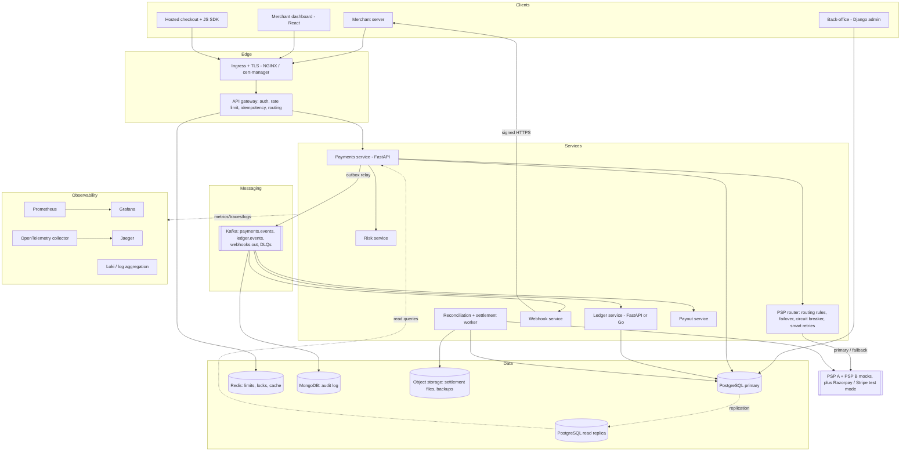
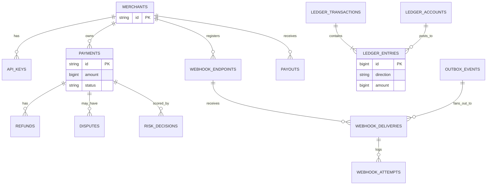
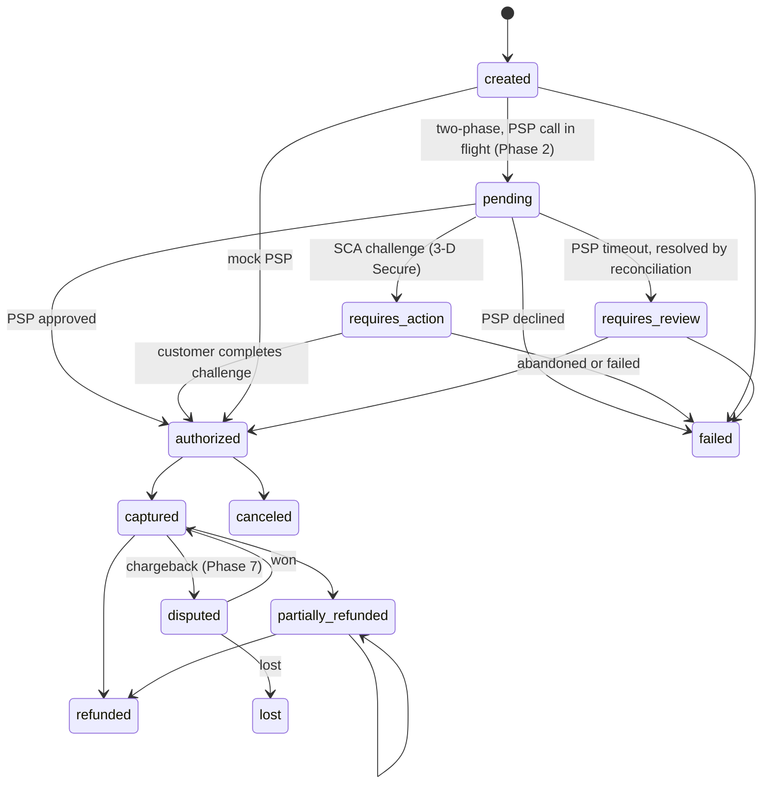
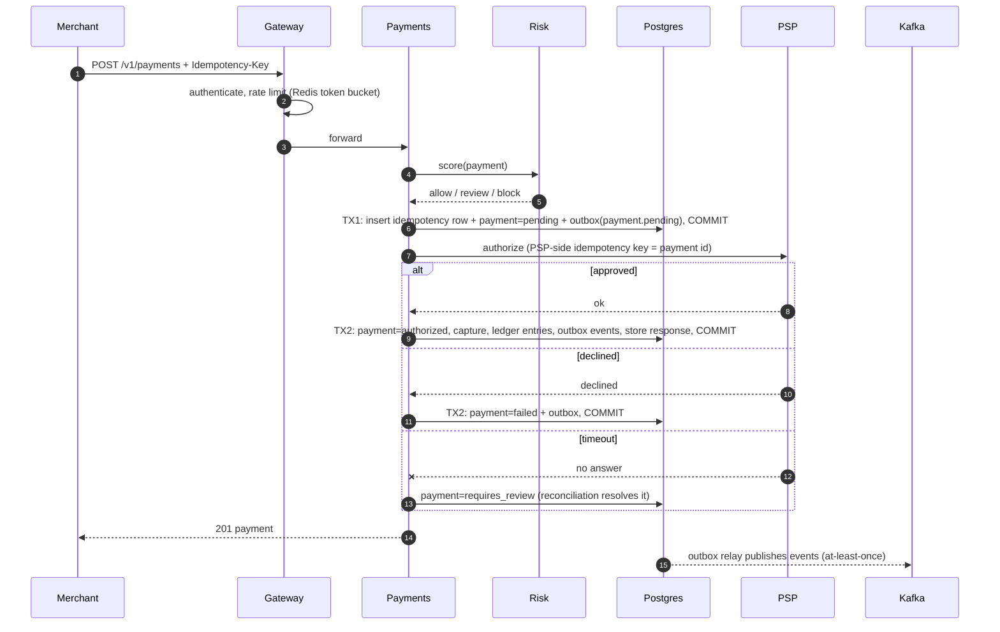
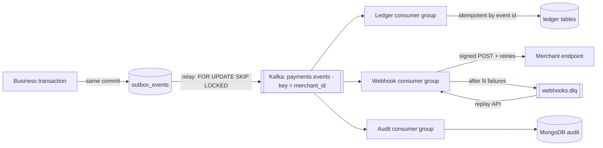
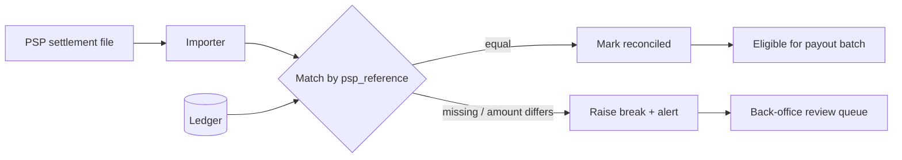
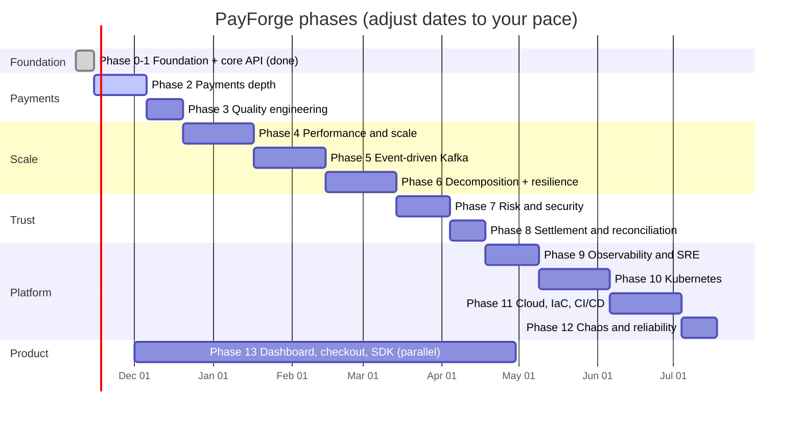

# PayForge: Master Project Plan

A production-grade, multi-tenant **payments platform** (a miniature Stripe / Razorpay), built phase by
phase to learn and demonstrate global-standard backend, distributed-systems, cloud and DevOps
engineering. Diagrams are Mermaid: they render on GitHub and in VS Code (install "Markdown Preview
Mermaid Support").

- Status snapshot: **Phases 0-1 done, Phase 2 partly done** (see section 14).
- Companion docs: [ARCHITECTURE.md](ARCHITECTURE.md) (decisions so far), [ROADMAP.md](ROADMAP.md) (short checklist),
  [LEARNING_LOG.md](LEARNING_LOG.md) (your engineering notes).

---

## 0. Levels, effort budget and feasibility rules

The plan is deliberately layered so the project is **ambitious but never all-or-nothing**. You can stop after any level
with something genuinely resume-worthy.

### 0.1 Three levels

| Level | Name | Phases | Effort | You end up with |
|---|---|---|---|---|
| **L1** | Core (resume-ready) | 0-4 + a minimal Phase 5 | about 120-160 h (3-4 months at 10 h/week) | idempotent payments, double-entry ledger, two-phase PSP flow with failover, measured performance, Kafka basics |
| **L2** | Advanced | rest of 5-11 (mandatory slices) | about +190-220 h | event-driven design, 2 extracted services, security review, SLO observability, Kubernetes, one real cloud deployment |
| **L3** | Elite (pick 2 of 10) | menu in 0.2 | about +60-100 h per pair | the differentiators that make interviewers lean forward |

### 0.2 Elite menu (pick any two; each is a self-contained, interview-grade story)

| # | Elite item | What you build | Why it impresses |
|---|---|---|---|
| E1 | **Formal + model-based verification** | a small **TLA+** spec of idempotency + outbox, model-checked; plus the stateful property tests from Phase 3 | few candidates can show a verified protocol |
| E2 | **Event-sourced ledger** | ledger rebuilt from an immutable event stream, snapshots, replay, projection rebuild | deep CQRS / event-sourcing trade-offs |
| E3 | **Multi-tenant hardening** | Postgres **Row-Level Security**, per-tenant quotas, noisy-neighbor test | SaaS isolation, a real production concern |
| E4 | **CDC outbox** | **Debezium** reads the WAL instead of a polling relay; benchmark both | latency/ordering/load trade-offs |
| E5 | **Subscriptions engine** | recurring billing scheduler, dunning (retry on failed renewals), proration, invoices | a whole new domain on top of payments |
| E6 | **Adaptive PSP routing** | live success-rate and cost scoring picks the PSP; shadow-mode evaluation | how real orchestrators (Juspay, Stripe) save money |
| E7 | **Go ledger service** | rewrite the hot path in Go; benchmark against Python | polyglot performance reasoning |
| E8 | **GitOps + progressive delivery** | Argo CD + Argo Rollouts, canary with SLO-gated automatic rollback | platform-engineering depth |
| E9 | **Jepsen-style consistency harness** | concurrent clients + fault injection + checker that proves no lost/duplicate money | distributed-systems credibility |
| E10 | **ML-lite fraud scoring** | simple model on synthetic data, feature store in Redis, shadow mode before enforcing | risk engineering + MLOps basics |

### 0.3 Effort budget and cut lines (hours are estimates for one person)

| Phase | Must (hours) | Stretch (hours) | **Cut line: mandatory** | Stretch (only if time) |
|---|---|---|---|---|
| 0-1 | done | | | |
| 2 Payments depth | 40 | 25 | two-phase PSP flow, adapter interface, 2 mock PSPs with failover, basic payouts, idempotency cleanup | disputes, Razorpay/Stripe test adapters, SCA flow, key scopes |
| 3 Quality | 20 | 10 | Hypothesis ledger properties, stateful model test, mypy, coverage gate | contract tests, mutation testing |
| 4 Performance | 40 | 20 | k6 baseline, 4 measured optimizations, pooling, Redis cache | PgBouncer, read replica, partitioning, RLS, adaptive concurrency |
| 5 Events | 40 | 25 | outbox to Kafka, one idempotent consumer, DLQ, lag metric | saga, CQRS read model, schema registry, CDC |
| 6 Decomposition | 30 | 20 | extract webhook service, timeouts + circuit breaker, graceful shutdown | gateway service, ledger split, mTLS |
| 7 Security + risk | 30 | 20 | key scopes + rotation, risk rules, audit log, CI scans, threat model | envelope encryption, token vault, request signing, ML scoring |
| 8 Settlement | 15 | 10 | reconcile job, breaks queue, invariant checker | trial balance reports, multi-currency |
| 9 Observability | 25 | 15 | metrics, dashboards, traces, 2 SLOs, 3 alerts + runbooks | Loki logs, burn-rate alerts, synthetic probe |
| 10 Kubernetes | 40 | 30 | manifests/Helm on kind, probes, resources, HPA, secrets | KEDA, network policies, Strimzi, operators |
| 11 Cloud + CI/CD | 35 | 25 | Terraform for 1 VM, deploy pipeline to staging+prod, backups + one restore drill | multi-env approvals, signed images, DR write-up |
| 12 Chaos | 15 | 15 | 4 experiments with reports | game day, soak test |
| 13 Product surface | 40 | 30 | dashboard payouts + API keys + logs | hosted checkout, JS SDK, Django back-office |

### 0.4 Feasibility rules (follow these and the project stays doable)

1. **Walking skeleton first.** Get a thin end-to-end slice of each phase working before adding depth.
2. **WIP limit of one.** One phase and one new technology at a time.
3. **Spike, then decide.** Time-box unknowns to 4-6 hours, then write an ADR; no endless research.
4. **Configure before you build.** Build it yourself only where building is the learning goal (ledger, outbox,
   idempotency, rate limiter, PSP router). Use off-the-shelf tools for the rest.
5. **Local first, cloud last.** Everything is developed on your laptop; cloud arrives in Phase 11.
6. **Measure before optimizing.** No experiment without a hypothesis and a before/after number.
7. **Main is always green and deployable.** Unfinished work hides behind feature flags.
8. **Re-plan every 4 weeks.** Drop or swap scope, never quality.
9. **A phase is done only when it passes the quality gates in section 11.**

### 0.5 Resource profiles (so it runs on an 8-16 GB laptop)

Use Docker Compose **profiles** to start only what a phase needs. Numbers are rough; check your own with `docker stats`.

| Profile | Services | Approx RAM | Used in phases |
|---|---|---|---|
| `core` | postgres, redis, api, worker, web | 1.5-2 GB | 0-4 |
| `events` | core + one Kafka broker (KRaft) | +1 GB | 5-6 |
| `obs` | core + Prometheus, Grafana, Loki, Jaeger | +1.5-2 GB | 9 |
| `k8s` | a kind/k3d cluster (1 control plane + 2 workers); run **instead of** compose | 4-6 GB | 10-12 |

Cap WSL's memory so Docker can't starve Windows: create `%UserProfile%\.wslconfig` with
`[wsl2]` / `memory=6GB` / `processors=4` (use roughly half your RAM), then `wsl --shutdown` and restart Docker Desktop.

---

## 1. Vision, scope and success criteria

**Vision:** other businesses (merchants) integrate with one API to accept money safely. PayForge must never
lose, duplicate or invent money, even when servers crash, networks fail or requests are retried.

**In scope:** payment API, ledger, payouts, refunds, disputes, webhooks, risk engine, reconciliation,
merchant dashboard and checkout, observability, Kubernetes and cloud delivery.
**Out of scope (on purpose):** real money movement, card-number storage (you only ever handle tokens),
KYC/AML integrations, native mobile apps.

**Measurable success criteria (the "definition of done" for the whole project):**

| Area | Target | Proven by |
|---|---|---|
| Correctness | Ledger always balances; zero lost or duplicated payments under failure | invariant job + chaos test report |
| Idempotency | N concurrent retries create exactly 1 payment | concurrency test (exists) + load test |
| Throughput | 500+ create-payment requests/s sustained on free-tier hardware (stretch: 1,000) | k6 report in `docs/perf/` |
| Latency | p99 under 150 ms at 500 req/s (excluding PSP time) | k6 + Grafana screenshot |
| Availability | 99.9% SLO with alerts and an error-budget policy | SLO dashboard |
| Recovery | Pod/broker/DB-replica loss: no data loss, recovery under 2 minutes | chaos test report |
| DR | Restore from backup tested; RPO under 5 min, RTO under 30 min (documented, drilled) | DR drill report |
| Security | OWASP API Top 10 reviewed; secrets never in git; dependency + image scans green | threat model + CI |
| Orchestration | PSP A fully down: payments continue on PSP B, never double-charged | failover test + chaos experiment |
| Isolation | one tenant at 10x load moves other tenants' p99 by less than 10% | noisy-neighbor test |
| Delivery | Push to main = tested, scanned, built, deployed with rollback | GitHub Actions history |

---

## 2. Concept coverage matrix (nothing missed)

Every concept you listed, and the phase that teaches it. Tick them off in your learning log.

| Area | Concepts | Phase |
|---|---|---|
| **API design** | REST resources, versioning (`/v1`), pagination (cursor), error envelope, idempotency keys, rate limits, OpenAPI, webhooks, SDK | 1, 2, 13 |
| **Databases** | schema design, constraints, indexes, ACID, isolation levels, row locks, optimistic locking, `EXPLAIN`, migrations, partitioning, replicas, backups/PITR | 1, 2, 4, 11 |
| **Concurrency** | race conditions, `SELECT FOR UPDATE`, `SKIP LOCKED`, deadlocks, unique-constraint serialization, threads vs async | 1, 2, 4 |
| **Distributed systems** | outbox, saga, at-least-once vs exactly-once-effect, eventual consistency, CQRS, event sourcing trade-offs, ordering, clocks, leader election (via Kafka/K8s) | 2, 5, 6 |
| **Messaging** | Kafka topics, partitions, consumer groups, offsets, DLQ, schema evolution, replay | 5 |
| **Caching** | cache-aside, TTLs, invalidation, stampede protection, Redis data structures | 4 |
| **Scaling** | horizontal scaling, stateless services, pooling (SQLAlchemy, PgBouncer), read replicas, partitioning/sharding, backpressure, HPA | 4, 10 |
| **Resilience** | timeouts, retries with jitter, circuit breaker, bulkhead, graceful shutdown, fail-open vs fail-closed, chaos testing | 6, 12 |
| **Payments domain** | PSP flow, authorize/capture, refunds, chargebacks, settlement, reconciliation, fees, double-entry accounting, payouts, tokenization, PCI scope | 2, 7, 8 |
| **Security** | authN/authZ, API key hashing + rotation, HMAC signing, SSRF, secrets management, encryption at rest/in transit, PII, audit logs, OWASP, supply chain | 7 |
| **Observability** | structured logs, metrics, traces, dashboards, SLI/SLO, alerts, runbooks, postmortems | 9 |
| **Testing** | unit, integration, contract, property-based, load/stress/soak, chaos, mutation (optional) | 3, 4, 12 |
| **Containers** | Dockerfile best practice, multi-stage, non-root, image scanning, compose | 0, 10 |
| **Kubernetes** | pods, deployments, services, ingress, config/secrets, probes, resources, HPA/KEDA, PDB, network policy, RBAC, StatefulSets, Helm, operators, GitOps | 10 |
| **Cloud + IaC** | free-tier topology, Terraform, networking, DNS/TLS, object storage, cost control | 11 |
| **CI/CD** | lint, test, build, scan, publish, deploy, environments, canary/blue-green, rollback, migrations in pipeline | 0, 11 |
| **Frontend** | merchant dashboard, hosted checkout, JS SDK, admin back-office (Django) | 13 |
| **Engineering practice** | Git flow, PRs, ADRs, docs, code review checklist, learning log | all |
| **Payment orchestration** | multi-PSP routing, failover, smart retries (soft vs hard declines), per-PSP circuit breaker, 3-D Secure / SCA flow | 2, E6 |
| **Multi-tenancy** | Row-Level Security, per-tenant quotas and rate plans, bulkheads, noisy-neighbor testing | 4, 7, E3 |
| **Formal and model-based verification** | stateful property tests, TLA+ spec, Jepsen-style checker | 3, E1, E9 |
| **Platform engineering and FinOps** | resource profiles, feature flags, cost alerts, golden path, GitOps | 0, 11, E8 |
| **Billing domain** | subscriptions, dunning, proration, invoices | E5 |

---

## 3. Target architecture



**Today's code** is a modular monolith (`api` + `worker`) that already contains the payments, ledger, outbox, webhook and
rate-limit modules. Phase 6 splits it only when the reasons are measurable (independent scaling, failure isolation, team
ownership). That migration story is itself an interview topic.

### Service responsibilities and data ownership

| Service | Owns | Does | Talks to |
|---|---|---|---|
| Gateway | API keys, rate-limit buckets, idempotency records | authenticate, limit, dedupe, route | Redis, Postgres |
| Payments | `payments`, `refunds`, payment state machine | create/capture/cancel/refund, PSP calls (two-phase) | PSP, Risk, outbox |
| Ledger | `ledger_*` tables (append-only) | post balanced transactions, balances, reports | consumes payment events |
| Webhook | endpoints, deliveries, attempts | sign, deliver, retry, DLQ, replay | consumes events, merchants |
| Risk | rules, decisions, velocity counters | allow/review/block | Redis, Payments |
| Reconciliation | settlement files, mismatches | compare PSP report vs ledger, raise breaks | PSP, Ledger, object storage |
| Payout | payout batches | move merchant balance out (ledger transaction) | Ledger, PSP |

Rule: **a service never reads another service's tables.** It uses an API or consumes events. This is what makes services
independently deployable.

---

## 4. Domain model and state machines


Built today: merchants, api_keys, payments, refunds, ledger_*, idempotency_keys, outbox_events, webhook_*.
Added later: disputes (7), payouts (8), risk_decisions (7), settlement_batches (8).



---

## 5. Core flows

### 5.1 Create payment (target, two-phase with a real PSP)



Why two transactions: never hold a database transaction (and its locks) open across a slow network call. The `pending` row
plus the PSP's own idempotency key make a crash at any point recoverable.

### 5.2 Event delivery (outbox to Kafka to webhooks)



Guarantees to be able to explain: **at-least-once delivery + idempotent consumers = exactly-once effect.** Ordering is
guaranteed per partition, so partition by `merchant_id`.

### 5.3 Reconciliation and settlement (daily)



---

## 6. Phase plan

Each phase has: **goal, build list, concepts to master, deliverable, how you prove it, interview questions.**
Estimates assume 8-10 hours a week. Do not skip the "prove it" column; the evidence is what makes the project credible.

### Phase 0 - Foundation and tooling  (DONE)
- **Goal:** a repo anyone can clone and run in one command.
- **Build:** monorepo, Docker Compose (db, redis, api, worker, web), Alembic migrations, `.env` handling, GitHub Actions
  CI (lint, tests, image build), pytest on real Postgres/Redis.
- **Concepts:** containers, 12-factor config, migrations, CI.
- **Prove it:** green CI badge; `docker compose up` works on a fresh machine.
- **Interview:** "Why test against a real database instead of mocks?" "What is a migration and why is it versioned?"

### Phase 1 - Core payments API  (DONE)
- **Build:** merchants + hashed API keys, payment state machine, capture/cancel/refund, cursor pagination, error envelope.
- **Concepts:** REST design, money as integers, state machines, tenant isolation, ACID.
- **Prove it:** 36 passing tests including cross-tenant access (404) and refund maths.
- **Interview:** "Why never store money as float?" "How do you prevent one merchant reading another's data?"

### Phase 2 - Payments depth  (IN PROGRESS, about 3 weeks left)
- **Build:**
  1. Idempotency + double-entry ledger + DB triggers (done).
  2. **Two-phase PSP call** (section 5.1): `pending` commit, PSP call, result transaction; PSP-side idempotency key.
  3. **PSP adapter interface** with Mock, Razorpay (test mode) and Stripe (test mode) implementations.
  4. `requires_review` state + a reconciliation hook for unknown outcomes (timeouts).
  5. **Payouts:** merchant balance to payout batches as ledger transactions (`DR merchant balance / CR payouts payable`).
  6. **Disputes/chargebacks:** state, ledger reversal, evidence upload record.
  7. Idempotency-key cleanup job (24h TTL), API versioning policy, OpenAPI polish, API-key rotation and scopes.
  8. Tokenization concept: client sends a PSP token, never card data; document the PCI-DSS scope this avoids.
  9. **PSP orchestration (the advanced part):** a router in front of the adapters with routing rules (currency, amount,
     method to preferred PSP), **automatic failover** to a second PSP on timeout/5xx, a **per-PSP circuit breaker and
     health score**, and **smart retries** (retry soft declines only, never hard declines, and never create a second charge:
     one idempotency key per attempt chain). Log every routing decision. Use two mock PSPs with configurable latency and
     failure rates so failover can be demonstrated on demand.
  10. (Stretch) **3-D Secure / SCA simulation:** a `requires_action` state with redirect-and-return, completed by a webhook
      from the PSP; document how this changes the state machine and idempotency.
- **Concepts:** ACID and isolation levels (READ COMMITTED vs SERIALIZABLE), why not to hold locks across network calls, PSP
  idempotency, authorization vs capture, chargebacks, settlement timing, PCI scope.
- **Deliverable:** `docs/adr/` entries for each decision; a PSP adapter test suite that runs against all adapters.
- **Prove it:** test that kills the process between TX1 and the PSP call and shows the payment is recoverable; ledger invariant
  test after 10,000 randomized operations.
- **Interview:** "What happens if the PSP charges the card but your server dies before recording it?" "Explain authorize vs capture."

### Phase 3 - Quality engineering
- **Build:** property-based tests (Hypothesis) for the ledger and refund maths, plus a **stateful model-based test** (random sequences
  of create/capture/cancel/refund, checked against a simple in-memory model and the ledger invariants); contract tests for the API (schemathesis against
  OpenAPI); `mypy` strict typing; `pre-commit` hooks; coverage gate (80%+) in CI; test data factories; mutation testing on
  `ledger.py` (optional); a code-review checklist.
- **Concepts:** test pyramid, flaky-test hygiene, invariants vs examples, shift-left.
- **Prove it:** CI fails on lint, type, coverage or schema drift; Hypothesis finds (and you fix) at least one edge case.
- **Interview:** "How do you test code that must never lose money?" "Unit vs integration vs contract tests."

### Phase 4 - Performance and scale
- **Build:**
  1. Baseline with **k6**: smoke, load, stress, spike, soak. Record p50/p95/p99, error rate, saturation.
  2. Profile; `EXPLAIN (ANALYZE, BUFFERS)` every hot query; add or drop indexes; fix N+1.
  3. **Connection pooling**: tune SQLAlchemy pool, add **PgBouncer** (transaction mode); compare.
  4. **Redis cache-aside** for API-key lookup and merchant config; stampede protection; invalidation on key revoke.
  5. Rate-limiter tuning and per-plan limits; `Retry-After` and client back-off guidance.
  6. Server tuning: Gunicorn + Uvicorn workers, thread pool size, keep-alive, request timeouts.
  7. **Postgres:** a read replica for list/report queries; **partition** `ledger_entries` and `outbox_events` by month;
     autovacuum tuning; archiving old rows.
  8. Backpressure: bounded queues, load shedding (HTTP 503) before collapse.
  9. **Multi-tenant isolation:** Postgres **Row-Level Security** so an application bug still cannot read another merchant's
     rows; per-tenant quotas and rate plans; per-tenant concurrency limits (bulkheads); a **noisy-neighbor test** (one tenant
     at 10x load, others' p99 must hold).
  10. **Adaptive concurrency:** cap in-flight requests by observed latency; priority lanes so capture/refund keep working
      while list/report queries are shed first.
- **Concepts:** Little's law, queueing, tail latency, pool sizing, index selectivity, caching trade-offs, hot rows,
  horizontal vs vertical scaling, amdahl-style limits.
- **Deliverable:** `docs/perf/` with each experiment: hypothesis, change, before/after chart.
- **Prove it:** a table of "change to throughput/p99" for at least 6 optimizations; the 500 req/s target met.
- **Interview:** "Your API is slow. Walk me through diagnosing it." "How do you size a connection pool?"

### Phase 5 - Event-driven architecture (Kafka)
- **Build:**
  1. Kafka (KRaft) via compose; **outbox relay publishes to Kafka** (replaces direct delivery).
  2. Topics: `payments.events` (key = merchant_id), `ledger.events`, `webhooks.out`, `*.dlq`. Retention and compaction chosen
     and justified.
  3. Consumers: webhook delivery, audit (to MongoDB), analytics projection. **Idempotent consumers** (processed-event table).
  4. **Saga** for multi-step flows (authorize, capture, ledger, notify) with compensating actions; choose orchestration
     vs choreography and write the ADR.
  5. **CQRS read model** for the dashboard (denormalized, built from events).
  6. Event schema versioning (JSON Schema or Avro + registry); backward-compatible evolution rules.
  7. Consumer lag metric and alert; replay tooling.
  8. (Stretch) Compare the polling outbox relay with **CDC via Debezium** (reads the Postgres WAL) on latency, database
     load and ordering; record the result in an ADR (Elite item E4).
- **Concepts:** partitions, ordering, consumer groups, rebalancing, offset commits, delivery semantics, exactly-once-effect,
  dead-letter queues, eventual consistency, event sourcing vs event notification.
- **Deliverable:** event catalog (`docs/events.md`) listing every event, schema, producer, consumers.
- **Prove it:** kill a consumer mid-batch and show no event is lost or double-applied; replay a topic and rebuild a read model.
- **Interview:** "How do you keep a database and Kafka consistent?" "What is exactly-once and is it real?"

### Phase 6 - Service decomposition and resilience patterns
- **Build:** split out the **ledger**, **webhook** and **risk** services (strangler approach: extract behind an interface,
  run both, switch). API gateway service. Inter-service calls with **timeouts, retries with jitter, circuit breakers,
  bulkheads**; graceful shutdown; health/readiness/startup probes; service-to-service auth (mTLS or signed tokens).
  Write one performance-critical service (ledger or rate limiter) in **Go** to compare against Python.
- **Concepts:** bounded contexts, data ownership, distributed monolith anti-pattern, contract versioning, fail-fast, load
  shedding, cascading failure, CAP in practice.
- **Deliverable:** ADR "Why we split" with measured reasons; consumer-driven contract tests between services.
- **Prove it:** take down the risk service and show payments degrade gracefully (configurable fail-open/closed).
- **Interview:** "Monolith or microservices, and how did you decide?" "What is a circuit breaker?"

### Phase 7 - Risk, security and compliance
- **Build:**
  1. **Risk engine:** velocity limits (Redis counters), amount thresholds, blocklists, risk score, allow/review/block, decision log.
  2. **Auth:** API key scopes and rotation, key expiry, IP allow-lists; dashboard sessions with short-lived JWT + refresh; RBAC.
  3. **Request signing** option (HMAC) in addition to bearer keys; replay protection (timestamp + nonce).
  4. **Encryption:** TLS everywhere, **envelope encryption** for webhook secrets and PII, key rotation, secrets in a manager
     (Kubernetes Secrets + SOPS or external secrets), never in git.
  5. **Audit log** (append-only, MongoDB) of every sensitive action; tamper-evidence (hash chain).
  6. **Threat model** (STRIDE) and an OWASP API Top 10 checklist with evidence.
  7. Supply chain: Dependabot, `pip-audit`, Trivy (images), CodeQL/Bandit (SAST), SBOM, signed images (cosign).
  8. Privacy: data retention, PII minimization, deletion workflow (GDPR-style), log scrubbing.
  9. Compliance literacy doc: PCI-DSS scope (SAQ-A vs SAQ-D), why tokens matter, SOC 2 basics.
  10. (Stretch) **Token vault** as an isolated service (its own database, network policy and access log) so sensitive
      identifiers live in a tiny, heavily protected perimeter, which is exactly how real platforms shrink PCI scope.
  11. (Stretch, Elite E10) **Fraud model in shadow mode:** a simple model on synthetic data scores payments but does not
      block them; compare its decisions with the rules engine before ever enforcing it.
- **Concepts:** authN vs authZ, least privilege, defense in depth, SSRF, replay attacks, timing attacks
  (`compare_digest`), key management, STRIDE.
- **Prove it:** a security test suite (authz bypass attempts, SSRF, replay, mass assignment); scan reports in CI.
- **Interview:** "How do you store API keys?" "How do you stop a merchant pointing webhooks at your internal network?"

### Phase 8 - Settlement, reconciliation and financial controls
- **Build:** settlement file importer (CSV in object storage); **daily reconciliation job** (section 5.3); breaks queue with
  resolution workflow; **trial balance** and ledger report endpoints; payout batch generation after settlement; scheduled
  **invariant checker** (debits = credits, no negative platform balance, captured = ledger sum) that alerts on any violation;
  fee schedule versioning; multi-currency accounts (FX as a documented extension).
- **Concepts:** settlement vs authorization, float, reconciliation breaks, accounting identities, immutability and
  correcting entries, audit trail.
- **Prove it:** inject a deliberate mismatch and show it is detected, alerted and resolved with correcting entries.
- **Interview:** "How do you know your books are right?" "What is a reconciliation break and how do you fix it?"

### Phase 9 - Observability and SRE
- **Build:** structured JSON logs with request/trace ids (Loki); **Prometheus** RED/USE metrics and business metrics
  (payments/min, success rate, ledger imbalance = 0, webhook lag); **OpenTelemetry** tracing across gateway, services,
  Kafka and Postgres, viewed in Jaeger; **Grafana** dashboards (service, business, infra); **SLIs/SLOs** with error budgets;
  **alerts** (burn-rate) to a channel; **runbooks** per alert; synthetic probe that makes a test payment every minute;
  incident **postmortem template** and one practiced incident.
- **Concepts:** the three pillars, cardinality, golden signals, SLI vs SLO vs SLA, burn-rate alerting, MTTR, blameless
  postmortems, on-call hygiene.
- **Prove it:** an alert fires during a chaos experiment and the runbook resolves it; trace shows one payment end to end.
- **Interview:** "How do you decide what to alert on?" "Debug a latency spike using only dashboards and traces."

### Phase 10 - Containers and Kubernetes
- **Build:**
  1. **Hardened images:** multi-stage, non-root, read-only filesystem, minimal base, `.dockerignore`, pinned versions, Trivy clean.
  2. Local cluster (kind or k3d). Manifests for every service: Deployment, Service, ConfigMap, Secret, Ingress.
  3. **Probes** (liveness, readiness, startup), **resource requests/limits**, graceful termination (`preStop`, SIGTERM handling),
     **PodDisruptionBudget**, topology spread.
  4. **HPA** on CPU, then **KEDA** on Kafka consumer lag.
  5. **NetworkPolicies** (default deny), RBAC and ServiceAccounts, Pod Security Standards.
  6. **Stateful workloads:** Kafka with **Strimzi**, Postgres via an operator (CloudNativePG) or managed free tier; PVCs and
     StorageClasses; backup CronJob.
  7. **Helm chart** for the platform with per-environment values; **cert-manager** for TLS; ingress-nginx.
  8. **GitOps** with Argo CD (or Flux); progressive delivery with **Argo Rollouts** (canary) and automatic rollback on SLO breach.
- **Concepts:** the Kubernetes control loop, scheduling, requests vs limits (throttling and OOM), rolling updates, service
  discovery (DNS), StatefulSet vs Deployment, operators, declarative infrastructure, GitOps.
- **Prove it:** drain a node while a load test runs with zero failed payments; rollout of a bad version rolls back automatically.
- **Interview:** "What happens when you `kubectl apply` a Deployment?" "Why do readiness and liveness probes differ?"

### Phase 11 - Cloud, infrastructure as code and CI/CD
- **Build:**
  1. **Free-tier topology** (verify current limits; see section 9): k3s on an always-free ARM VM, managed free Postgres and
     Redis as alternatives, object storage for backups and settlement files, Cloudflare for DNS/TLS/WAF.
  2. **Terraform** for networking, VM, DNS, buckets; remote state; modules; `plan` in PRs, `apply` on merge.
  3. **GitHub Actions** pipeline: lint, type-check, unit + integration tests, SAST, dependency scan, build, **Trivy scan**,
     push to GHCR, SBOM, sign, deploy to **staging**, smoke test, manual approval, deploy to **prod**, auto-rollback.
  4. Environments (dev, staging, prod), branch protection, required checks, CODEOWNERS, semantic versioning and release notes.
  5. **DB migrations in the pipeline** (expand/contract pattern for zero-downtime) and rollback policy.
  6. **Backups and DR:** Postgres base backups + WAL (PITR), restore drill with timing, documented RPO/RTO; active-passive
     multi-region design document (not built); cost budget alerts.
- **Concepts:** immutable infrastructure, IaC drift, environment parity, blue-green vs canary, secrets in CI (OIDC instead
  of long-lived keys), expand/contract migrations, backup vs replication, RPO/RTO.
- **Prove it:** merge to `main` deploys to staging automatically; a destroyed environment is rebuilt from code in under 30 min;
  a PITR restore is timed and recorded.
- **Interview:** "How do you deploy a breaking DB change with zero downtime?" "Backup vs replica?"

### Phase 12 - Reliability engineering and chaos
- **Build:** failure-injection suite (Chaos Mesh or scripts): kill API pods, kill the DB primary, drop Kafka brokers, add
  network latency/partition to the PSP, fill the disk, expire a TLS cert, clock skew; **game days**; soak test (8h+);
  data-integrity proof after every experiment (ledger balances, no lost/duplicate payments, outbox drained).
- **Concepts:** steady-state hypothesis, blast radius, failure domains, graceful degradation, recovery testing.
- **Prove it:** `docs/chaos/` report per experiment: hypothesis, injection, observed behavior, fix, re-run.
- **Interview:** "What is the worst failure you injected and what did it teach you?"

### Phase 13 - Product surface: dashboard, checkout, SDK, back-office (runs in parallel from Phase 2)
- **Build:** merchant dashboard (payments, refunds, payouts, API keys with test/live mode, webhook logs + replay, analytics
  charts, team members); **hosted checkout page** and a small **JS SDK** that tokenizes without touching your servers;
  **Django back-office** (admin for support/ops: merchants, disputes, reconciliation breaks, webhook failures) reading via
  API or a read replica; accessibility and responsive design; E2E tests (Playwright).
- **Concepts:** API-first design, CORS, CSP, session vs token auth for dashboards, SDK ergonomics, admin tooling safety
  (audit every staff action).
- **Prove it:** a 2-minute demo video: signup, integrate, pay, refund, replay a failed webhook.

---

## 7. Cross-cutting tracks (done continuously, not as phases)

| Track | Practice |
|---|---|
| **Git** | trunk-based with short branches; Conventional Commits; PRs with a checklist; protected `main`; tags for releases |
| **Docs** | one **ADR** per significant decision in `docs/adr/` (context, options, decision, consequences); update diagrams with code |
| **Learning log** | one entry per problem solved (template in `LEARNING_LOG.md`): these become interview stories |
| **Testing** | every bug gets a regression test first; no merge without green CI |
| **Security** | secrets never committed; dependency updates weekly; threat model revisited each phase |
| **Cost** | stay on free tiers; billing alerts on any cloud account that holds a card |
| **Weekly rhythm** | Mon plan, midweek build, Fri measure + write log + demo to yourself |

---

## 8. Target repository layout

```
payforge/
  docs/ PROJECT_PLAN.md  ARCHITECTURE.md  events.md  adr/  perf/  chaos/  runbooks/  threat-model.md  dr/
  services/
    gateway/  payments/  ledger/  webhook/  risk/  reconciliation/  payout/
  libs/                shared: money, ids, signing, outbox, telemetry
  web/                 merchant dashboard (React) + checkout + sdk/
  backoffice/          Django admin
  deploy/
    compose/           docker-compose for local
    helm/payforge/     chart + values-{dev,staging,prod}.yaml
    argocd/            app definitions
    terraform/         modules + envs
  tests/ e2e/  load/ (k6)  chaos/  contract/
  scripts/             demo, receivers, seeders
  .github/workflows/   ci.yml  deploy.yml  security.yml  terraform.yml
```
Today everything lives under `api/` and `web/`; move to this layout during Phase 6 (do not restructure earlier).

---

## 9. Free-tier infrastructure map (verify current limits before relying on them)

| Need | Free option | Notes |
|---|---|---|
| Source + CI | GitHub + Actions | public repos get generous minutes |
| Container registry | GHCR | free for public images |
| Local Kubernetes | kind / k3d / minikube | all learning can happen here at zero cost |
| Cloud Kubernetes | k3s on an always-free ARM VM (e.g. Oracle) | card needed for verification; reclaim policies apply |
| Postgres / Redis / Mongo | local containers; free tiers (Neon, Upstash, Atlas M0) as fallbacks | |
| Kafka | Strimzi in cluster; local compose | free cloud Kafka tiers are limited |
| Object storage | S3-compatible free tiers (Cloudflare R2, etc.) | settlement files, backups |
| DNS / TLS / WAF | Cloudflare free plan | |
| Observability | Prometheus, Grafana, Loki, Jaeger (self-hosted); Grafana Cloud free tier | |
| Load generation | k6 (local) | |

Decision rule: **develop and test everything locally; deploy to cloud only in Phase 11.**

---

## 10. Timeline (part-time, about 8-10 hours a week)


Total at this pace: L1 about 3-4 months, L1+L2 about 8-9 months, plus an Elite pair about 10-11 months (see section 0).
**Minimum resume-ready cut = L1: Phases 0-4 + a short Phase 5**;
everything after that raises the ceiling, it does not gate your applications. Start applying after Phase 4, keep building.

---

## 11. Quality gates (a phase is done only when all are true)

1. Code merged via PR with green CI (lint, types, tests, scans).
2. New behavior has tests, including at least one failure-mode test.
3. Metrics or evidence recorded in `docs/` (benchmark, chaos report, or test output).
4. ADR written for each design decision.
5. Diagram and README updated.
6. Learning-log entry written with an interview-ready explanation.
7. Demo works from a clean clone with `docker compose up`.

---

## 12. Risk register

| Risk | Likelihood | Mitigation |
|---|---|---|
| Scope creep / never finishing | high | the minimum cut in section 10; one phase at a time; time-box |
| Free-tier limits or account rejection | medium | develop locally first; keep a cheap VPS as a fallback |
| Laptop too small for Kafka + k8s + DB together | medium | run subsets; close other apps; use cloud free tiers for data stores |
| Over-engineering microservices too early | medium | split only with measured reasons (Phase 6 ADR) |
| Plausible but wrong money logic | high impact | property tests, DB constraints, invariant checker, reconciliation |
| Secrets leaked to git | medium | `.gitignore`, pre-commit secret scan, GitHub secret scanning |
| Burnout | medium | weekly rhythm; ship small; celebrate each green phase |

---

## 13. Interview and resume mapping

| After phase | You can claim | Typical questions you can now answer |
|---|---|---|
| 2 | Idempotent payments API with a double-entry ledger, two-phase PSP integration | double charges, authorize vs capture, PSP timeouts |
| 4 | "Sustained 500 req/s at p99 under 150 ms; cut latency X% via indexing, pooling, caching" | diagnosing slowness, pool sizing, caching |
| 5 | Event-driven architecture with transactional outbox, Kafka, saga | DB + queue consistency, exactly-once, ordering |
| 7 | Security-reviewed platform (threat model, scans, envelope encryption, audit log) | API key storage, SSRF, replay, PCI scope |
| 9 | SLO-driven operations with tracing and burn-rate alerts | what to alert on, debugging with traces |
| 10-11 | Kubernetes + Terraform + GitOps delivery with canary and rollback | zero-downtime deploys, migrations, backups vs replicas |
| 12 | Chaos-tested; zero data loss under injected failures | worst failure you caused, blast radius |

**Big-tech note:** projects get you past the resume screen and give you stories, but Google/Meta/Microsoft-style loops weigh
**data structures and algorithms and system design** most. Reserve about half of your study time for DSA (LeetCode patterns)
and practice system design out loud using this project as your example. A good split: 5 hours project, 4 hours DSA, 1 hour
system-design reading per week.

---

## 14. Status snapshot (update this as you go)

| Phase | Status | Notes |
|---|---|---|
| 0 Foundation | done | compose, CI, migrations, tests |
| 1 Core API | done | payments, refunds, auth, pagination |
| 2 Payments depth | in progress | idempotency, ledger, outbox, webhooks done; two-phase PSP, payouts, disputes, rotation pending |
| 3-12 | not started | |
| 13 Product surface | started | React dashboard exists (payments, new payment, webhooks) |

**Next 5 actions:**
1. Write ADR-001 "Money as integers" and ADR-002 "Idempotency inside the business transaction".
2. Implement the PSP adapter interface and the `pending` state (two-phase flow).
3. Add the idempotency-key cleanup job.
4. Add Hypothesis property tests for refund maths and ledger balance.
5. Start the k6 baseline script in `load/` and record your first p99.

---

## 15. Glossary

**Idempotency** same request repeated has the same effect as once. **Outbox** event saved in the same transaction as the data
change. **Saga** multi-step workflow with compensating actions instead of a distributed transaction. **CQRS** separate write
and read models. **DLQ** dead-letter queue for messages that keep failing. **SLI/SLO/SLA** measured indicator, internal target,
contractual promise. **RPO/RTO** how much data you can lose, how long recovery may take. **PITR** point-in-time recovery.
**HPA/KEDA** Kubernetes autoscalers (resource-based / event-based). **PDB** limit on voluntary pod disruption. **GitOps** the
cluster state is whatever git says. **Strimzi** Kubernetes operator for Kafka. **PSP** payment service provider.
**Reconciliation** comparing your records with the provider's to find breaks. **PCI-DSS** card-industry security standard.
**RLS** Row-Level Security: the database itself filters rows per tenant. **CDC** change data capture: stream database
changes from the WAL. **SCA / 3-D Secure** extra customer authentication step for card payments. **Bulkhead** isolating
resources per tenant or function so one cannot starve the rest. **Shadow mode** running a new decision system alongside the
live one without acting on it. **TLA+** a language for specifying and model-checking concurrent protocols.
